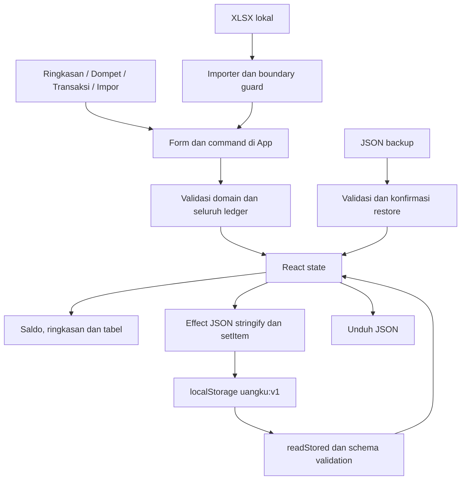

# WEBSITE FINANCE AUDIT — Uangku

Tanggal audit: **26 Oktober 2026**, konteks waktu Europe/Istanbul. Mode: **evaluasi saja, tanpa implementasi**.

Objek: https://zayyan353.github.io/uangku/ dan source /workspace/uangku pada commit **716229dba1928965bf971325b503eb9dfe0f341d**. Semua nominal contoh dalam laporan ini adalah **data sintetis**, bukan saldo pribadi pengguna.

Audit mencakup engineering, sistem keuangan, QA, UI/UX, keamanan/integritas, dan product management. Pengujian dilakukan pada salinan terisolasi di /tmp/uangku-audit, memakai browser context baru. Tidak ada perbaikan, autofix, migrasi, commit, push, deployment, perubahan konfigurasi environment, atau perubahan catatan pengguna.

## 1. Executive Summary

**Kesimpulan utama: fondasi pencatatan dan perhitungan nominal normal berfungsi, tetapi aplikasi belum layak menjadi satu-satunya catatan keuangan yang diandalkan.** Pengujian membuktikan kehilangan transaksi lintas tab, duplikasi pada salah satu interleaving impor, dan ekspor cadangan yang dapat ditolak pemulihannya sendiri.

Tercatat **20 temuan: 1 P0, 2 P1, 15 P2, dan 2 P3**. Ini bukan skor kualitas dan bukan 20 kerentanan keamanan: daftar mencakup bug, keterbatasan alur/produk, konfigurasi risiko bersyarat, accessibility, performa, dan technical debt.

Yang sudah baik: integer minor unit, penjumlahan terjaga, pemisahan currency, transfer internal tidak menjadi income/expense, biaya tercatat sekali, kurs per transaksi dikonfirmasi, kategori dapat ditunda, bulk review menjaga nominal, parser memiliki validasi dan batas sumber daya, serta data rusak tidak otomatis ditimpa.

Prioritas tertinggi:

- **DATA-001/P0:** tab usang menimpa transaksi tab lain yang sudah tersimpan.
- **BUG-001/P1:** transaksi manual setelah pratinjau bisa ikut diimpor kembali.
- **DATA-002/P1:** state valid diekspor menjadi file melebihi batas restore.

### Metode dan kekuatan bukti

| Pemeriksaan | Hasil dan batas interpretasi |
|---|---|
| Versi produksi | HTTPS berhasil; HTML live identik byte-per-byte dengan build yang diperiksa: 430.450 byte, SHA-256 3b6f1b7bc9723dea1fc8ff98763d8f8483f9f3cbbe82ebfa2261fc8d1058c281. |
| Suite unit bawaan | **163 tes lulus**, enam file, dijalankan pada salinan. |
| Type-check/build | Berhasil pada salinan; output aplikasi asli tidak dibangun ulang. |
| Suite browser bawaan | **39 skenario lulus** pada salinan. Ini tidak membuktikan semua kondisi aman. |
| QA independen | 11 probe selesai tanpa error harness; empat menunjukkan kegagalan/gap dan tujuh mengonfirmasi kontrol. Kehilangan lintas tab diulang auditor induk dengan hasil sama. |
| Keuangan independen | 15 probe Node, termasuk 250 fixture transfer dalam satu probe; lima skenario browser unik dan dua follow-up tanggal posting. Assertion audit lulus dapat berarti bug berhasil direproduksi. |
| Keamanan | Tujuh probe fungsi lulus; browser membuktikan roundtrip backup besar gagal serta kontrol XSS literal/restore invalid. npm audit melaporkan nol advisory saat audit. |
| File pengguna | Satu XLSX Ziraat yang sebelumnya diberikan dibaca **tanpa perubahan**: 73 baris, TRY, 24 September–23 Oktober 2026; saldo akhir hasil ledger sesuai file dan reimport dikenali duplikat. Tidak menyimpan atau menampilkan nilai/identitas rekeningnya dalam laporan. |
| UI/UX | Empat halaman pada viewport Chromium 1440, 768, 390, dan 320 px; fokus keyboard, alur cash/import/FX, computed contrast dan kasus tepi. Bukan pengujian perangkat fisik. |
| Performa | Bundle produksi, dataset sintetis 1k/5k/10k; helper sampai 65k tanpa render besar. Hasil bukan SLA, p95, atau benchmark HP. |

Bukti terinci sementara tersedia di /tmp/uangku-audit/evidence/{qa,finance,security,ux,architecture,root}. Inti bukti, precondition, reproduksi, dan acceptance criteria disalin ke laporan ini agar tidak bergantung pada keberlangsungan direktori sementara.

### Batas audit

Tidak mengakses profil browser/catatan nyata pengguna, kredensial, bank API, database produksi, atau sesi login. Tidak ada backend/database server dalam produk ini. Tidak dilakukan pen-test aktif produksi, pengujian fisik iOS/Android, Safari/Firefox, screen reader manual, crash OS, eviction storage, semua format bank, seluruh payload berbahaya, atau seluruh batas kapasitas UI. Tidak ada bukti kompromi produksi. Source/config dapat dibaca penuh; fungsi yang tidak tersedia dibedakan dari fungsi yang tidak dapat diverifikasi.

## 2. System Architecture Overview

Aplikasi adalah **SPA React 19.3.1 + TypeScript 5.9.3**, dibangun Vite 8.3.5 menjadi HTML mandiri dan dihosting GitHub Pages. Tidak ada server aplikasi, endpoint keuangan, database server, login pengguna, atau sinkronisasi rekening. Ini desain local-first yang sesuai MVP pribadi, bukan dengan sendirinya cacat.

- main.tsx memasang React StrictMode dan CSS.
- App.tsx mengelola navigasi, state, command, formulir, tabel, impor, backup, dan feedback.
- finance.ts berisi model, parsing/format uang, validasi, saldo, dan agregat bulanan.
- storage.ts memvalidasi envelope backup, ID/referensi, ukuran dan total; membaca storage secara defensif.
- importer.ts membaca ZIP/XML XLSX memakai fflate dan fast-xml-parser, memeriksa urutan saldo, lalu menghasilkan fingerprint dan entry.
- importRange.ts membatasi penambahan histori sebelum baseline.
- review.ts mengatur kategori massal serta kandidat pasangan transfer.
- preferences.ts menyimpan pilihan UI terpisah; BulkReviewPanel.tsx adalah komponen review terpisah.
- Ledger utama: localStorage **uangku:v1**. Preferensi: **uangku:preferences:v1**. Backup adalah JSON yang diunduh dan dipulihkan manual.

### Model dan batas operasional

Satu wallet memiliki satu currency dan opening balance. Entry memiliki satu tanggal dan salah satu type: income, expense, transfer, adjustment, atau unreviewed. Transfer menyimpan source amount, destination amount, rate, fee dan maksimal dua fingerprint, tetapi hanya satu tanggal.

Batas validator: 100 wallet, 100.000 entry, JSON 8 MiB; XLSX 8 MiB, maksimal 50.000 transaksi per workbook, 1.000 bagian ZIP, dan XML terpilih 32 MiB. Batas ini **bukan kapasitas pemakaian yang sudah terbukti**; kuota browser dan batas runtime dapat tercapai lebih dulu.

## 3. Existing Feature Inventory

Status berlaku untuk scope yang disebut, bukan jaminan bebas bug di semua kondisi.

| Fitur | Status | Dasar evaluasi |
|---|---|---|
| Demo dan mulai data sendiri | Functional | Konfirmasi menghasilkan 13 wallet kosong; demo dipisahkan. |
| Tambah/edit wallet dan opening | Functional | Alur normal dan validasi diuji; belum ada tanggal baseline. |
| Cash quick-entry dan catat lagi | Functional | Fokus, dompet terakhir, input ulang, tanpa duplikat kosong terverifikasi. |
| Pemasukan/pengeluaran normal | Functional | Tambah, edit, delete, cancel, validasi normal lulus. |
| Saldo yang disebut saat ini | Partially Functional | Nominal benar untuk ledger; future booking ikut dihitung, FIN-001. |
| Transfer satu currency dan biaya | Functional | Principal dipindah, fee sekali; overdraft terlihat. |
| FX manual/per jumlah diterima | Functional | Dua mode bekerja; konfirmasi rate wajib dan historis disimpan. |
| Pairing transfer hasil impor | Partially Functional | Saldo/dedup normal benar; tanggal per kaki hilang pada beda tanggal, FIN-003. |
| Penyesuaian/Cek saldo | Functional | Selisih signed tanpa income/expense; bukan rekonsiliasi historis penuh. |
| Ringkasan bulanan dan kategori | Partially Functional | Angka periode benar, label lampau salah, UX-004; bukan laporan closing historis. |
| Search/filter transaksi | Partially Functional | Filter aktif bekerja; histori umum tidak memiliki all-time search, UX-003. |
| Antrean perlu dirapikan | Functional | Seluruh currency/periode; selection reset dan jenis pending terjaga. |
| Kategori massal | Functional | Nominal/ID/fingerprint dijaga; konfirmasi type eksplisit. |
| XLSX Ziraat TRY, impor penuh | Functional | Sintetis dan satu file pengguna 73 baris diverifikasi. |
| Seleksi sebagian/pratinjau impor | Partially Functional | Filter/seleksi bekerja, tetapi ada commit overlap dan baseline gap, BUG-001/DATA-003. |
| Impor berulang/fingerprint | Partially Functional | Reimport normal lulus; perubahan manual/provenance memiliki batas FIN-002. |
| Backup/restore kecil dan invalid input | Functional | Roundtrip kecil, konfirmasi, dan invalid preservation lulus. |
| Backup/restore seluruh ukuran valid | Partially Functional | DATA-002 membuktikan file unduh normal dapat ditolak. |
| Persistensi satu tab/refresh | Functional | Lulus dalam kondisi storage tersedia. |
| Persistensi lintas tab | Partially Functional | DATA-001 membuktikan overwrite tanpa konflik. |
| Feedback saat storage gagal | Partially Functional | Alert dan RAM backup benar; indikator sukses bertentangan, BUG-002. |
| Responsif/aksesibilitas | Partially Functional | Tidak ada document overflow di empat viewport; enam temuan UX terukur. |
| Histori besar | Partially Functional | 10k lambat; helper65k gagal, ARCH-001/005. |
| CSV/PDF/bank selain Ziraat | Not Implemented | Bukan format yang diklaim didukung; bank lain dicatat manual. |
| Login, server DB, multi-device sync, bank API | Not Implemented | Keputusan local-only, bukan endpoint rusak. |
| Recurring, utang/cicilan, budget, target tabungan | Not Implemented | Relevansi perlu divalidasi; bukan seluruhnya wajib. |
| Investasi/revaluasi/forecast/historical closing | Not Implemented | Tidak menilai valuasi aset atau membuat proyeksi. |
| Safari/Firefox, perangkat fisik, assistive tech penuh | Not Verified | Tidak dijalankan pada audit ini. |

Tidak ditemukan satu fitur utama yang terbukti hanya berupa tampilan kosong tanpa wiring. Status Nonfunctional tidak dipaksakan ketika yang ditemukan adalah kegagalan bersyarat pada fitur yang umumnya bekerja.

## 4. Detailed Findings Register

Bukti dan rekomendasi lengkap ada pada bagian 5. Prefix ID mengikuti area; DATA-002 berasal dari pemeriksaan keamanan/recovery, sedangkan SEC-001 adalah risiko privasi bersyarat.

| ID | Kategori | Temuan | Prioritas | Dampak | Bukti | Rekomendasi |
|---|---|---|---|---|---|---|
| DATA-001 | Persistensi dan integritas data | Catatan tersimpan dapat hilang karena tab lain menimpa seluruh ledger | P0 | Kehilangan persisten atas catatan yang sebelumnya sudah dinyatakan tersimpan | Dua penyimpanan sukses → hanya satu entri persisten; direproduksi dua auditor. | Revision, deteksi konflik, dan koordinasi penulis. |
| BUG-001 | Impor dan deduplikasi | Transaksi manual yang dibuat setelah pratinjau impor dapat terhitung kembali | P1 | Pergerakan uang yang sama tercatat dua kali dan saldo rekening menyimpang | Kontrol 174,50 TRY; alur interleaved 154,50 TRY dengan dua debit identik. | Validasi ulang overlap manual saat commit. |
| DATA-002 | Backup dan pemulihan | Cadangan normal dapat ditolak oleh pemulihan aplikasi sendiri | P1 | Mekanisme pemindahan/pemulihan utama gagal pada ukuran tertentu | 4.635.049 byte diterima → ekspor 8.499.161 byte → ditolak pada limit 8.388.608. | Format dan anggaran ukuran backup/restore harus konsisten. |
| FIN-001 | Semantik waktu keuangan | Transaksi masa depan memengaruhi saldo berlabel “saat ini” | P2 | Pengguna dapat mengira dana rencana atau transaksi salah tanggal sudah tersedia | Opening 1.000 + future income 500 → “Saldo saat ini” 1.500. | Pisahkan atau batasi pencatatan masa depan. |
| FIN-002 | Provenance dan rekonsiliasi | Fakta mutasi dan perubahan manual tidak memiliki jejak override | P2 | Selisih dengan bank sulit dijelaskan; reassignment dapat mempertahankan klaim fingerprint untuk kaki dompet lama | Override tersimpan tanpa fakta asal; fingerprint mutasi lama tetap dianggap duplicate. | Pisahkan fakta bank, interpretasi, dan penanda override. |
| FIN-003 | Riwayat transfer dan impor | Pairing transfer beda tanggal menghilangkan tanggal posting dan memblokir impor sah | P2 | Histori lintas bulan berubah dan input bank sah tertahan | File overlap diterima sebelum merge, ditolak sesudah merge yang menggeser anchor ke November. | Pertahankan tanggal posting setiap kaki transfer. |
| DATA-003 | Baseline dan kelengkapan impor | Impor awal sebagian tidak memberi rekonsiliasi yang cukup dan sulit dilengkapi | P2 | Saldo yang menyerupai saldo rekening dapat berbeda dari bank dan recovery histori memerlukan langkah manual atau wallet baru | Subset menghasilkan 94,50 vs closing file 174,50; omitted backfill ditolak. | Rekonsiliasi pratinjau dan kebijakan baseline/backfill. |
| BUG-002 | Status persistensi dan feedback | Kegagalan penyimpanan masih disertai indikator “tersimpan” | P2 | Pengguna dapat menutup halaman berdasarkan indikator yang keliru dan kehilangan perubahan RAM | Durable 0, RAM 1, alert gagal dan label sukses tampil bersamaan. | Status simpan tunggal berbasis hasil durable write. |
| UX-001 | Accessibility | Kontras sebagian angka dan konteks keuangan gagal WCAG AA | P2 | Kategori, currency, status, dan nominal pemasukan sulit dibaca pada low vision/glare | Rasio teks penting 2,383–3,840:1, di bawah 4,5:1. | Perbaiki token kontras yang terukur. |
| UX-002 | Validasi dan feedback formulir | Alasan penolakan Save FX berada di luar viewport modal | P2 | Save tampak tidak bereaksi; pengguna mengulang klik atau meninggalkan transfer | Alert validasi dibuat tetapi jauh di bawah batas body modal. | Feedback terlihat dan fokus ke koreksi. |
| UX-003 | Pencarian dan navigasi histori | Pencarian historis membutuhkan bulan yang sudah diketahui | P2 | Pencarian memerlukan percobaan bulan/currency dan dapat memberi kesan data hilang. | Query sama: 0 pada bulan aktif, 1 setelah bulan tepat dipilih. | Scope pencarian historis dan empty state yang benar. |
| UX-004 | Penyajian informasi keuangan | Laporan periode lampau masih diberi judul “bulan ini” | P2 | Nilai masa lampau bisa dibaca sebagai kondisi bulan berjalan, terutama pada screenshot/perbandingan. | Data Januari ditampilkan dengan label bulan ini. | Judul periode mengikuti picker. |
| UX-005 | Responsive controls | Filter jenis transaksi sulit dibaca pada lebar 320 px | P2 | Pengguna sulit mengetahui filter aktif dan menjelaskan daftar yang terbatas/kosong; terkait UX-003. | Ruang teks 19,234 px untuk label 55,029 px. | Reflow filter mobile. |
| UX-006 | Keterbacaan nilai uang | Nominal besar terpotong tanpa disclosure yang jelas pada mobile 320 | P2 | Rekonsiliasi nilai besar/desimal memerlukan masuk ke editor dan berisiko salah baca. | Teks nominal 98 px dipotong dalam area 88 px. | Disclosure nominal utuh pada mobile. |
| SEC-001 | Konfigurasi privasi | Privasi dibatasi origin dan profil browser, bukan path project | P2 | Dampak potensial tinggi bila script tidak dipercaya mendapat origin/profil sama; prasyarat tersebut belum terbukti pada produksi | Shared-origin access terbukti pada fixture, bukan kompromi produksi. | Threat model dan isolasi origin bila diperlukan. |
| ARCH-001 | Performa antarmuka | Tabel merender seluruh hasil sehingga histori besar lambat digunakan | P2 | Pencarian/pilih-semua terasa membeku pada histori sah | 10k rows: 8,095 detik navigasi; long task5,487 detik. | Batasi render dengan pagination/windowing. |
| ARCH-002 | Skalabilitas model dan data flow | Pemrosesan sinkron dan scan berulang tumbuh superlinear | P2 | Biaya import/bulk/selection meningkat lebih cepat daripada jumlah data pada jalur tertentu; beban berikutnya mengurangi responsivitas. | Lookup1k→10k:1,215→121,234ms; append5,499→215,166ms. | Indeks dan validasi batch tanpa scan berulang. |
| ARCH-003 | Technical debt maintainability | UI, command dan persistensi terkonsentrasi di App.tsx | P3 | Cakupan perubahan/regresi membesar saat fitur bertambah; bukan alasan rewrite atau masalah saldo yang berdiri sendiri. | Lima komponen utama dan orchestration persistensi di berkas sama. | Pisahkan tanggung jawab secara bertahap. |
| ARCH-004 | Technical debt pengujian | Gate CI/publikasi belum menjalankan regression browser yang tersedia | P3 | Regresi modal, workflow, storage dan responsive dapat lolos build tanpa sinyal otomatis; gap pencegahan, bukan fitur rusak saat ini. | Dua workflow tidak memanggil skrip browser yang tersedia. | Gate browser sintetis untuk core workflow. |
| ARCH-005 | Kapasitas runtime dan validasi | Ledger valid65.000 entri gagal karena batas argumen native | P2 | Histori sah tidak dapat dihitung/divalidasi/dipulihkan; error mengarahkan pengguna pada nominal yang sebenarnya aman | 65k,6.619.056byte → stack overflow;60k kontrol benar. | Hindari spread array besar pada checkedSum. |

## 5. Detailed Issue Analysis

Semua rekomendasi berikut **belum diimplementasikan**. Lokasi singkat mengacu pada src/ di commit audit, kecuali path .github/README/package. Nomor rentang membantu review; tautan source GitHub dapat dipasangkan dengan commit audit agar tidak berubah ketika pengembangan berikutnya berlangsung.

### DATA-001 — Catatan tersimpan dapat hilang karena tab lain menimpa seluruh ledger

**Issue ID:** DATA-001. **Kategori:** Persistensi dan integritas data. **Status verifikasi:** Confirmed. **Prioritas:** P0.

**Lokasi:** App.tsx:394–416, 420–422, 477–484.

**Kondisi saat ini:** Setiap tab membaca satu snapshot awal dan menulis seluruh state ke localStorage tanpa revision atau pemeriksaan konflik.

**Kondisi yang seharusnya:** Dua penambahan yang dinyatakan tersimpan harus sama-sama bertahan, atau penulis yang memakai snapshot usang harus ditolak dengan jalur pemulihan.

**Bukti:** Tab A dan B dibuka saat ledger kosong. A menyimpan satu pengeluaran; B menyimpan pengeluaran berbeda dari snapshot kosong. Penyimpanan akhir berisi satu entri B, bukan dua. Setelah A direfresh, entri A hilang. Tidak ada conflict alert. Auditor induk mengulang dan memperoleh hasil sama.

**Langkah reproduksi:** Mulai data sendiri; buka dua tab pada origin sama; simpan pengeluaran 25 dari A dan 40 dari B; refresh A. Angka dan catatan pada pengujian sepenuhnya sintetis.

**Root cause:** localStorage.setItem bersifat atomik untuk satu penulisan, tetapi rangkaian read–modify–write lintas tab tidak atomik. Tidak ada storage listener, revision check, atau koordinasi penulis.

**Dampak dan risiko jika tidak diperbaiki:** Kehilangan persisten atas catatan yang sebelumnya sudah dinyatakan tersimpan. Prasyarat dua tab cukup umum; overwrite tidak membutuhkan klik pada milidetik yang sama. P0 mengikuti definisi pengguna tentang kehilangan data yang telah dibuktikan, bukan dugaan kompromi keamanan.

**Rekomendasi perbaikan:** Rancang penulisan dengan revision dan deteksi konflik, koordinasi/merge yang benar untuk create/edit/delete/restore, serta snapshot pemulihan. Storage listener saja belum menyelesaikan penulisan serentak.

**Estimasi kompleksitas:** Medium–High. **Dependencies:** Kontrak konflik dan status persistensi; terkait BUG-002.

**Acceptance criteria:** Dua tab menyimpan entri berbeda secara berurutan maupun serentak dan kedua ID bertahan setelah refresh. Edit, delete, bulk, dan restore usang tidak menimpa perubahan baru secara diam-diam; konflik dan pemulihannya terlihat.

### BUG-001 — Transaksi manual yang dibuat setelah pratinjau impor dapat terhitung kembali

**Issue ID:** BUG-001. **Kategori:** Impor dan deduplikasi. **Status verifikasi:** Confirmed. **Prioritas:** P1.

**Lokasi:** App.tsx:320–351, 500–508.

**Kondisi saat ini:** Kemungkinan tumpang tindih transaksi manual diperiksa saat file dibaca. Saat menyimpan, pemeriksaan diperbarui hanya untuk fingerprint impor dan batas tanggal.

**Kondisi yang seharusnya:** Seluruh asumsi yang memengaruhi pilihan pratinjau perlu diperiksa terhadap ledger terbaru sebelum commit impor.

**Bukti:** Statement sintetis: opening 120 TRY; -20, +100, -25,50; closing 174,50. Setelah pratinjau terbuka, tambahkan manual transaksi -20 yang sama. Simpan tiga baris: empat entri tersimpan dan saldo 154,50, bukan 174,50. Kontrol dengan manual dibuat sebelum membaca file memberi peringatan, mengimpor dua baris, dan menghasilkan 174,50.

**Langkah reproduksi:** Atur opening sintetis 120; buka pratinjau tiga mutasi; lewat tombol global catat transaksi -20 pada tanggal dan keterangan baris tertua; simpan pratinjau lama.

**Root cause:** Time-of-check/time-of-use gap: transaksi manual tidak memiliki sourceKey sehingga pembaruan knownKeys saat commit tidak menemukan tumpang tindih yang baru dibuat.

**Dampak dan risiko jika tidak diperbaiki:** Pergerakan uang yang sama tercatat dua kali dan saldo rekening menyimpang. Membutuhkan tindakan manual di sela pratinjau dan simpan, yang didukung UI.

**Rekomendasi perbaikan:** Gunakan satu validasi commit terhadap revision ledger terkini, termasuk kemungkinan overlap manual, dompet, baseline, dan pilihan. Minta tinjauan ulang ketika asumsi berubah. Kesamaan tanggal/nominal adalah kandidat, bukan bukti pasti duplikat.

**Estimasi kompleksitas:** Medium. **Dependencies:** Kebijakan revision DATA-001 dan baseline DATA-003.

**Acceptance criteria:** Manual-before-preview dan manual-after-preview menghasilkan peringatan/pilihan yang konsisten; setelah pengguna menerima baris yang tidak overlap, tersimpan tiga entri dengan saldo 174,50. Duplikat sah tetap dapat diputuskan pengguna secara eksplisit.

### DATA-002 — Cadangan normal dapat ditolak oleh pemulihan aplikasi sendiri

**Issue ID:** DATA-002. **Kategori:** Backup dan pemulihan. **Status verifikasi:** Confirmed. **Prioritas:** P1.

**Lokasi:** storage.ts:193–194; App.tsx:514, 525, 544.

**Kondisi saat ini:** Batas state dihitung dari JSON ringkas, ekspor normal memakai JSON berindentasi, sedangkan restore membatasi ukuran mentah file.

**Kondisi yang seharusnya:** Setiap state yang diterima dan diekspor normal harus dapat dipulihkan lewat UI tanpa mengedit JSON secara manual.

**Bukti:** Lewat UI, ledger sintetis 46.000 entri dipulihkan dari file ringkas 4.635.049 byte dan benar-benar tersimpan di Chromium. Tombol Cadangkan data menghasilkan 8.499.161 byte. File hasil unduh itu ditolak karena limit restore 8.388.608 byte. Ledger lama tidak terhapus saat penolakan.

**Langkah reproduksi:** Pulihkan fixture ringkas yang valid, unduh dengan tombol cadangan normal, lalu unggah file hasil unduh yang sama. Pengujian memakai transaksi historis sintetis sehingga tidak merender 46.000 baris.

**Root cause:** Dua representasi serialisasi dipakai untuk tiga keputusan kapasitas: validasi compact, ekspor pretty, dan pemeriksaan raw-file.

**Dampak dan risiko jika tidak diperbaiki:** Mekanisme pemindahan/pemulihan utama gagal pada ukuran tertentu. Ini P1, bukan P0: penolakan restore tidak langsung menghapus ledger yang masih tersedia.

**Rekomendasi perbaikan:** Selaraskan format ekspor dan batas pemulihan terhadap byte yang benar-benar diunduh; tambahkan roundtrip pada batas kapasitas. Jangan sekadar menaikkan limit tanpa memperhitungkan kuota browser.

**Estimasi kompleksitas:** Low–Medium. **Dependencies:** Kebijakan kapasitas bersama ARCH-005 dan status simpan BUG-002; tidak membutuhkan migrasi framework.

**Acceptance criteria:** Ekspor desktop dan seluler dari setiap ukuran state yang didukung dapat dipulihkan menjadi state identik. Uji tepat di bawah/atas batas; restore gagal tidak mengganti data lama.

### FIN-001 — Transaksi masa depan memengaruhi saldo berlabel “saat ini”

**Issue ID:** FIN-001. **Kategori:** Semantik waktu keuangan. **Status verifikasi:** Confirmed — perilaku dan ketidaksesuaian label. **Prioritas:** P2.

**Lokasi:** finance.ts:161, 199–229; App.tsx:223, 533–541.

**Kondisi saat ini:** Tanggal kalender masa depan diterima dan walletBalance menjumlah seluruh entri tanpa membedakan planned dan posted.

**Kondisi yang seharusnya:** Saldo yang disebut tersedia saat ini membedakan uang aktual dari rencana, atau pencatatan aktual memiliki aturan tanggal yang jelas.

**Bukti:** Pada 26 Oktober, wallet TRY opening 1.000 diberi pemasukan 500 tanggal 26 November. Saldo saat ini menjadi 1.500; pemasukan Oktober tetap nol dan transaksi tidak muncul di tabel Oktober. Ini bukan kesalahan penjumlahan.

**Langkah reproduksi:** Catat pemasukan bertanggal bulan depan pada wallet yang memiliki saldo awal, lalu bandingkan saldo kini dan laporan bulan berjalan.

**Root cause:** Model entry tidak memiliki status planned/posted dan agregasi all-date dipakai untuk label saldo kini.

**Dampak dan risiko jika tidak diperbaiki:** Pengguna dapat mengira dana rencana atau transaksi salah tanggal sudah tersedia. Cek saldo memakai agregasi yang sama.

**Rekomendasi perbaikan:** Tentukan kontrak tanggal aktual. Untuk MVP, validasi atau jelaskan tanggal depan; bila rencana dibutuhkan, pisahkan saldo posted dan planned. Forecasting tidak wajib ditambahkan.

**Estimasi kompleksitas:** Low–Medium. **Dependencies:** Definisi saldo aktual dan tanggal baseline.

**Acceptance criteria:** Fixture tidak diam-diam menambah 500 sebagai dana tersedia hari ini; entri masa depan tetap dapat ditemukan/dikoreksi, dan reconciliation mengikuti kontrak tanggal yang sama.

### FIN-002 — Fakta mutasi dan perubahan manual tidak memiliki jejak override

**Issue ID:** FIN-002. **Kategori:** Provenance dan rekonsiliasi. **Status verifikasi:** Confirmed — keterbatasan integritas sumber, bukan bug aritmetika. **Prioritas:** P2.

**Lokasi:** App.tsx:104, 172–199; importer.ts:218, 248, 305.

**Kondisi saat ini:** Sesudah review, nominal/dompet/tanggal hasil impor dapat diedit; fingerprint tetap dipertahankan, tetapi fakta bank asli dan penanda override tidak disimpan.

**Kondisi yang seharusnya:** Edit eksplisit tetap dapat dilakukan, dengan asal mutasi dan dampaknya terhadap rekonsiliasi dapat dilihat dan ditelusuri.

**Bukti:** POS impor 100 dari opening 500 diedit menjadi 999: saldo -499 benar secara matematis, tetapi baris bank asli tetap duplicate tanpa konteks override. Pada pasangan transfer, tujuan Bank B dipindah ke Cash C; kredit Bank B hilang dari ledger tetapi toSourceKey Bank B tetap melekat dan baris B tetap dianggap terwakili.

**Langkah reproduksi:** Impor mutasi sintetis, edit nominal yang sudah confirmed; atau pasangkan debit/kredit lalu ubah dompet tujuan transfer. Baca ulang file asli dan periksa fingerprint serta fakta ledger.

**Root cause:** Satu entry mutable merangkap fakta sumber bank, interpretasi pengguna, dan penanda deduplikasi.

**Dampak dan risiko jika tidak diperbaiki:** Selisih dengan bank sulit dijelaskan; reassignment dapat mempertahankan klaim fingerprint untuk kaki dompet lama. Tidak ada tuntutan agar reimport otomatis membatalkan perubahan pengguna.

**Rekomendasi perbaikan:** Pertahankan fakta sumber minimal dan metadata override; bedakan note/category dari perubahan uang/dompet/tanggal; sediakan koreksi/unpair yang menjelaskan efek kedua sisi.

**Estimasi kompleksitas:** Medium. **Dependencies:** Model kaki transfer FIN-003 dan compatibility backup.

**Acceptance criteria:** Perubahan uang/dompet/tanggal terlihat sebagai override dan dapat dibandingkan ke sumber; perubahan kategori tidak mengubah saldo; fingerprint dan relasi kaki tidak mengklaim transaksi pada dompet yang sudah tidak terwakili.

### FIN-003 — Pairing transfer beda tanggal menghilangkan tanggal posting dan memblokir impor sah

**Issue ID:** FIN-003. **Kategori:** Riwayat transfer dan impor. **Status verifikasi:** Confirmed. **Prioritas:** P2.

**Lokasi:** finance.ts:14; App.tsx:128, 185–199, 432; importRange.ts:34–38.

**Kondisi saat ini:** Dua kaki transfer yang dapat berselang tiga hari digabung menjadi satu entry dengan satu date, mengikuti sisi yang sedang direview.

**Kondisi yang seharusnya:** Tanggal posting masing-masing wallet tetap tersedia untuk histori dan boundary impor, meskipun principal tetap satu transfer internal.

**Bukti:** XLSX sintetis A: opening 500, debit 100 tanggal 31 Oktober, saldo 400. B: kredit 100 tanggal 2 November. File overlap A menambah debit sah 10 sesudah anchor pada 31 Oktober, saldo 390. Sebelum pairing, parser dan range menerima tambahan. Setelah pairing dari kredit B, transfer bertanggal 2 November dan tambahan A ditolak sebagai sebelum batas awal. Saldo sebelum tambahan tetap benar.

**Langkah reproduksi:** Impor dua posting, uji file overlap A, review kredit B dengan pasangan A, lalu uji file overlap yang sama. Kedua file benar-benar melewati parser XLSX.

**Root cause:** Dua fingerprint dipertahankan tanpa dua tanggal posting; filter dan range validator memperlakukan satu date sebagai tanggal kedua wallet.

**Dampak dan risiko jika tidak diperbaiki:** Histori lintas bulan berubah dan input bank sah tertahan. Bukan principal ganda atau kerusakan seluruh saldo.

**Rekomendasi perbaikan:** Simpan metadata tanggal per kaki dan gunakan sesuai wallet pada histori/boundary. Alternatif terbatas: jelaskan dan tolak pairing beda tanggal sampai model mendukungnya.

**Estimasi kompleksitas:** Medium. **Dependencies:** Provenance FIN-002 dan kompatibilitas backup.

**Acceptance criteria:** Pairing dari debit maupun kredit mempertahankan kedua tanggal; October A/November B benar; overlap A diterima sebelum dan sesudah pairing; saldo, biaya, dan dedup tetap konsisten.

### DATA-003 — Impor awal sebagian tidak memberi rekonsiliasi yang cukup dan sulit dilengkapi

**Issue ID:** DATA-003. **Kategori:** Baseline dan kelengkapan impor. **Status verifikasi:** Confirmed — keterbatasan alur, bukan rumus salah. **Prioritas:** P2.

**Lokasi:** App.tsx:289, 349–370; importer.ts:284–295; importRange.ts:34–38.

**Kondisi saat ini:** Pilihan subset tetap memakai opening seluruh file; baris yang dihilangkan sebelum catatan pertama kemudian dapat ditolak oleh guard backfill.

**Kondisi yang seharusnya:** Dampak subset terhadap saldo dan cara melengkapinya harus jelas; tidak diasumsikan semua pilihan akan sama dengan closing bank.

**Bukti:** File opening 120, pergerakan -20,+100,-25,50, closing 174,50. Pilih hanya debit terbaru -25,50: ledger menjadi 94,50. Ini aritmetika benar untuk ledger terpilih. Impor ulang dua baris lebih lama kemudian diblokir. Tidak ada peringatan rekonsiliasi subset di pratinjau.

**Langkah reproduksi:** Pada wallet kosong, pilih hanya mutasi terbaru dan opening default; simpan, kemudian unggah seluruh file untuk melengkapi baris lama.

**Root cause:** Tidak ada tanggal baseline/metadata rekonsiliasi; baseline seluruh file dipakai untuk subset apa pun, sedangkan validator sengaja menolak penambahan pre-baseline yang tidak pasti.

**Dampak dan risiko jika tidak diperbaiki:** Saldo yang menyerupai saldo rekening dapat berbeda dari bank dan recovery histori memerlukan langkah manual atau wallet baru. README memang mengingatkan perlunya seluruh transaksi relevan; masalahnya guardrail UI dan recovery.

**Rekomendasi perbaikan:** Tentukan semantik subset, tampilkan proyeksi saldo serta selisih terhadap statement, dan sediakan jalur backfill/reimport yang aman. Jangan melemahkan penolakan lama tanpa desain baseline.

**Estimasi kompleksitas:** Medium. **Dependencies:** Keputusan baseline dan metadata FIN-002/FIN-003; terkait BUG-001.

**Acceptance criteria:** Preview menjelaskan gap saldo subset; kebijakan periode/baseline eksplisit; baris yang sengaja dilewati memiliki jalur pemulihan aman; kontrol impor penuh tetap 174,50.

### BUG-002 — Kegagalan penyimpanan masih disertai indikator “tersimpan”

**Issue ID:** BUG-002. **Kategori:** Status persistensi dan feedback. **Status verifikasi:** Confirmed. **Prioritas:** P2.

**Lokasi:** App.tsx:412–416, 493, 525, 544.

**Kondisi saat ini:** Kegagalan setItem menampilkan alert yang benar, tetapi toast, sidebar, dan footer tetap menyebut transaksi/data tersimpan.

**Kondisi yang seharusnya:** Status RAM, pending write, tersimpan, dan gagal konsisten pada semua permukaan UI.

**Bukti:** QuotaExceededError diinjeksi deterministik: durable ledger nol, RAM satu, recovery download satu. Bersamaan dengan alert penuh/tidak tersedia, toast mengatakan Transaksi tersimpan dan sidebar/footer tetap menyatakan tersimpan. Setelah storage dipulihkan dan transaksi berikutnya dibuat, dua entri bertahan.

**Langkah reproduksi:** Gunakan fresh context, buat setItem melempar error, simpan transaksi, bandingkan UI, localStorage, dan recovery JSON. Ini simulasi error, bukan disk benar-benar penuh.

**Root cause:** Sukses validasi/in-memory update dianggap sukses persistensi; beberapa label statis tidak mengikuti hasil write.

**Dampak dan risiko jika tidak diperbaiki:** Pengguna dapat menutup halaman berdasarkan indikator yang keliru dan kehilangan perubahan RAM. Alert dan recovery backup berfungsi; error bukan sepenuhnya disembunyikan.

**Rekomendasi perbaikan:** Gunakan satu status persistensi dan hasil durable write untuk toast/sidebar/footer; pertimbangkan retry tanpa memerlukan transaksi baru.

**Estimasi kompleksitas:** Low–Medium. **Dependencies:** Kontrak persistensi DATA-001.

**Acceptance criteria:** Saat durable nol/RAM satu, semua indikator menyatakan belum tersimpan; recovery memuat RAM terbaru; retry berhasil mengubah status tanpa mutasi keuangan tambahan.

### UX-001 — Kontras sebagian angka dan konteks keuangan gagal WCAG AA

**Issue ID:** UX-001. **Kategori:** Accessibility. **Status verifikasi:** Confirmed — computed CSS dan perhitungan sRGB. **Prioritas:** P2.

**Lokasi:** styles.css:112, 114, 136, 169, 176, 258, 326, 336, 361, 409; App.tsx:265.

**Kondisi saat ini:** Sejumlah teks 9–12 px memakai warna terlalu pucat pada putih.

**Kondisi yang seharusnya:** Teks normal yang menyampaikan informasi memenuhi rasio minimal 4,5:1; pengecualian teks besar tidak berlaku pada contoh ini.

**Bukti:** Pemasukan tabel #6e8b4f 12px/600: 3,840:1; label income/expense #8a9282 12px: 3,224:1; helper bulk #a0ac92 11px: 2,383:1. Pembanding pengeluaran tabel lulus 5,394:1. Rasio memakai computed foreground/background, bukan sampel anti-aliasing screenshot.

**Langkah reproduksi:** Buka fixture dashboard/tabel; ambil computed CSS, hitung linear sRGB dan rasio luminance.

**Root cause:** Token warna sekunder dan amount-positive kurang gelap pada background aktual.

**Dampak dan risiko jika tidak diperbaiki:** Kategori, currency, status, dan nominal pemasukan sulit dibaca pada low vision/glare. Ini kegagalan kontras terukur, bukan preferensi warna.

**Rekomendasi perbaikan:** Tetapkan token teks berdasarkan rasio yang diuji pada desktop/mobile dan semua state; periksa non-text contrast secara terpisah.

**Estimasi kompleksitas:** Low. **Dependencies:** Tidak ada; konsistensi token dan overrides.

**Acceptance criteria:** Contoh teks dan state lain memenuhi 4,5:1 pada background sebenarnya, tanpa mengandalkan ukuran font yang tidak termasuk large text.

### UX-002 — Alasan penolakan Save FX berada di luar viewport modal

**Issue ID:** UX-002. **Kategori:** Validasi dan feedback formulir. **Status verifikasi:** Confirmed. **Prioritas:** P2.

**Lokasi:** App.tsx:166–171, 239–241; styles.css:240–246.

**Kondisi saat ini:** Validasi benar memblokir transfer yang belum dikonfirmasi, tetapi alert berada di akhir body scroll dan fokus tetap di Save.

**Kondisi yang seharusnya:** Penolakan langsung memperlihatkan alasan dan lokasi koreksi tanpa pengguna menebak bahwa harus scroll.

**Bukti:** Pada 320×844, posisi alert sekitar y1122 sedangkan body modal berakhir y750; pada 390 alert y1073 vs750, desktop 1440 alert y930 vs737. scrollTop tetap nol. Tidak ada data tersimpan.

**Langkah reproduksi:** Pilih USD→TRY, isi amount100/rate44, biarkan checkbox konfirmasi kosong, klik Simpan. Uji pada tiga viewport.

**Root cause:** setError tidak diikuti pengaturan fokus/scroll, sedangkan footer terlihat terpisah dari error di body.

**Dampak dan risiko jika tidak diperbaiki:** Save tampak tidak bereaksi; pengguna mengulang klik atau meninggalkan transfer. Tombol bukan nonfunctional dan role=alert sudah ada; screen reader manual belum diuji.

**Rekomendasi perbaikan:** Tempatkan ringkasan error dekat action atau fokus/scroll ke field/error; kaitkan pesan dengan field terkait.

**Estimasi kompleksitas:** Low. **Dependencies:** Tidak ada; pertahankan aturan konfirmasi kurs.

**Acceptance criteria:** Alasan penolakan terlihat dan target koreksi jelas pada 320/390/768/1440 serta viewport pendek; valid Save tetap benar.

### UX-003 — Pencarian historis membutuhkan bulan yang sudah diketahui

**Issue ID:** UX-003. **Kategori:** Pencarian dan navigasi histori. **Status verifikasi:** Confirmed — keterbatasan fungsi dan empty state. **Prioritas:** P2.

**Lokasi:** App.tsx:249, 429–436, 531, 542.

**Kondisi saat ini:** Query biasa selalu dibatasi bulan dan currency aktif; tidak ada seluruh histori untuk catatan yang sudah rapi.

**Kondisi yang seharusnya:** Pengguna dapat menemukan transaksi berdasarkan keterangan tanpa menebak bulan, atau scope dan cara memperluas pencarian dijelaskan.

**Bukti:** Asuransi historis audit tanggal 12 Januari 2025 menghasilkan nol hasil di Oktober 2026; query yang sama memberi satu hasil setelah bulan Januari 2025 dipilih. Empty state mengatakan mulai mencatat/impor, padahal catatan ada.

**Langkah reproduksi:** Seed transaksi lama sintetis, cari keterangannya pada bulan sekarang, lalu ubah picker ke bulan transaksi.

**Root cause:** inCurrency dan inMonth selalu digabung query, kecuali pending queue; empty component tidak membedakan database kosong dan nol kecocokan.

**Dampak dan risiko jika tidak diperbaiki:** Pencarian memerlukan percobaan bulan/currency dan dapat memberi kesan data hilang.

**Rekomendasi perbaikan:** Tambahkan scope seluruh periode, perjelas currency, dan bedakan empty hasil filter dari first-use empty; jaga identitas currency pada hasil.

**Estimasi kompleksitas:** Medium. **Dependencies:** Seleksi massal harus tetap mengikuti scope hasil.

**Acceptance criteria:** Transaksi lama ditemukan tanpa mengetahui bulan sebelumnya; zero-result menyebut filter dan memberi cara memperluas, tidak menyuruh memasukkan ulang catatan yang ada.

### UX-004 — Laporan periode lampau masih diberi judul “bulan ini”

**Issue ID:** UX-004. **Kategori:** Penyajian informasi keuangan. **Status verifikasi:** Confirmed. **Prioritas:** P2.

**Lokasi:** App.tsx:534, 537; finance.ts:222.

**Kondisi saat ini:** Nilai mengikuti month picker, tetapi label income, expense, dan kategori tetap hardcoded bulan ini.

**Kondisi yang seharusnya:** Nama periode pada judul sesuai agregat yang ditampilkan; saldo kini tetap dibedakan dari arus kas periode.

**Bukti:** Pilih Januari 2025: pengeluaran sintetis Rp54.321 benar untuk Januari, tetapi judul tetap Pengeluaran bulan ini. Saldo kini yang all-time memang diberi label tersendiri dan tidak dilaporkan sebagai bug perhitungan.

**Langkah reproduksi:** Pilih bulan lampau dengan transaksi, baca judul kartu dan kategori, lalu kembali ke bulan berjalan.

**Root cause:** Label tidak diturunkan dari state month.

**Dampak dan risiko jika tidak diperbaiki:** Nilai masa lampau bisa dibaca sebagai kondisi bulan berjalan, terutama pada screenshot/perbandingan.

**Rekomendasi perbaikan:** Gunakan nama bulan/tahun terpilih secara konsisten pada kartu dan grafik kategori.

**Estimasi kompleksitas:** Low. **Dependencies:** Tidak ada.

**Acceptance criteria:** Semua judul agregat mengikuti bulan yang dipilih tanpa mengubah nominal; saldo kini tetap jelas.

### UX-005 — Filter jenis transaksi sulit dibaca pada lebar 320 px

**Issue ID:** UX-005. **Kategori:** Responsive controls. **Status verifikasi:** Confirmed. **Prioritas:** P2.

**Lokasi:** styles.css:210–212, 546–548; App.tsx:542.

**Kondisi saat ini:** Select dapat menyusut sampai hampir hanya panah ketika bersaing dengan count dan tombol Rapikan.

**Kondisi yang seharusnya:** Opsi filter terpilih dapat dibaca tanpa membuka dropdown pada viewport yang didukung.

**Bukti:** Pada 320 px, select 59,234 px; padding menyisakan 19,234 px untuk teks yang memerlukan 55,029 px. Pada 390 pilihan terbaca. Kontrol masih dapat diklik.

**Langkah reproduksi:** Tampilkan tiga transaksi dengan dua pending global pada 320 px dan lihat filterbar.

**Root cause:** Flex select memiliki min-width:0 sementara count/action mempertahankan lebar.

**Dampak dan risiko jika tidak diperbaiki:** Pengguna sulit mengetahui filter aktif dan menjelaskan daftar yang terbatas/kosong; terkait UX-003.

**Rekomendasi perbaikan:** Reflow count/action atau letakkan select pada baris penuh dengan lebar minimum yang memadai.

**Estimasi kompleksitas:** Low. **Dependencies:** Koordinasi layout dengan UX-006.

**Acceptance criteria:** Opsi termasuk Perlu dirapikan terbaca pada 320/390 dan zoom ekuivalen, tanpa document overflow.

### UX-006 — Nominal besar terpotong tanpa disclosure yang jelas pada mobile 320

**Issue ID:** UX-006. **Kategori:** Keterbacaan nilai uang. **Status verifikasi:** Confirmed — kasus batas. **Prioritas:** P2.

**Lokasi:** styles.css:648–668; App.tsx:265.

**Kondisi saat ini:** Nilai memakai nowrap, overflow hidden dan ellipsis pada kolom mobile; tidak ada disclosure read-only/title yang jelas.

**Kondisi yang seharusnya:** Seluruh digit/desimal dapat diperiksa langsung atau lewat detail read-only yang dapat diakses touch/keyboard.

**Bukti:** Rp123.456.789,01 pada 320 menghasilkan scrollWidth98 > clientWidth88 dan terpotong. Pada 390 muat. Rp1.234.567,89 masih muat pada320; jadi ini bukan kegagalan semua nominal. Editor memberi workaround, bukan kerusakan nilai tersimpan.

**Langkah reproduksi:** Tampilkan expense sintetis besar itu di tabel pada 320, periksa lebar teks dan elemen full-value.

**Root cause:** Lebar kolom dibatasi lalu bagian nilai disembunyikan.

**Dampak dan risiko jika tidak diperbaiki:** Rekonsiliasi nilai besar/desimal memerlukan masuk ke editor dan berisiko salah baca.

**Rekomendasi perbaikan:** Gunakan ruang penuh, wrap yang terbaca, atau detail read-only berisi nilai/currency lengkap; jangan bergantung hover tooltip saja.

**Estimasi kompleksitas:** Low–Medium. **Dependencies:** Layout UX-005.

**Acceptance criteria:** Nilai besar, negatif, dan dua currency transfer dapat diperiksa utuh pada320 tanpa mengedit data atau document overflow.

### SEC-001 — Privasi dibatasi origin dan profil browser, bukan path project

**Issue ID:** SEC-001. **Kategori:** Konfigurasi privasi. **Status verifikasi:** Confirmed untuk konfigurasi; kompromi/pencurian nyata Not Tested. **Prioritas:** P2.

**Lokasi:** storage.ts:6, 203–205; App.tsx:414, 525, 544; README.md:62–68.

**Kondisi saat ini:** Ledger dan backup berupa JSON plaintext. Semua script yang sudah dapat berjalan pada origin sama memiliki akses localStorage; path /uangku/ bukan boundary terpisah.

**Kondisi yang seharusnya:** Klaim lokal/pribadi menjelaskan batas kepercayaan yang tepat; origin hosting sesuai dengan project/script lain yang dipercaya.

**Bukti:** Probe sintetis pada sibling path origin sama membaca ledger. Ini tidak membuktikan project produksi lain disusupi, akses lintas-origin, atau pencurian data nyata. Source tidak menunjukkan pengiriman catatan ke server aplikasi/bank.

**Langkah reproduksi:** Pada context sintetis, simpan data lalu baca key yang sama dari halaman path berbeda tetapi scheme/host/port sama.

**Root cause:** Cakupan localStorage adalah origin, bukan path. Tidak ada lapisan akun/enkripsi tambahan dalam desain lokal ini.

**Dampak dan risiko jika tidak diperbaiki:** Dampak potensial tinggi bila script tidak dipercaya mendapat origin/profil sama; prasyarat tersebut belum terbukti pada produksi. Ketiadaan login bukan dengan sendirinya bug.

**Rekomendasi perbaikan:** Jelaskan boundary origin/profil dan backup plaintext. Pertimbangkan origin khusus jika project lain pada domain tidak sepenuhnya dipercaya; kebutuhan enkripsi mengikuti threat model, bukan otomatis migrasi backend.

**Estimasi kompleksitas:** Low untuk disclosure; Medium untuk isolasi origin/migrasi. **Dependencies:** Pemulihan andal DATA-002 sebelum memindahkan origin.

**Acceptance criteria:** Dokumentasi tidak menyiratkan isolasi antarpath; bila origin dipisahkan, sibling project tidak bisa membaca ledger; migrasi sintetis menjaga data.

### ARCH-001 — Tabel merender seluruh hasil sehingga histori besar lambat digunakan

**Issue ID:** ARCH-001. **Kategori:** Performa antarmuka. **Status verifikasi:** Confirmed — pengukuran terbatas. **Prioritas:** P2.

**Lokasi:** App.tsx:245–269, 375–385, 542.

**Kondisi saat ini:** Seluruh baris hasil transaksi dan pratinjau dibuat sebagai DOM, tanpa pagination/windowing.

**Kondisi yang seharusnya:** Jumlah DOM/render yang aktif terikat ukuran halaman/viewport, bukan total seluruh histori.

**Bukti:** Bundle produksi, desktop tak dithrottle: 1k/5k/10k entri membutuhkan 861/3.965/8.095 ms untuk membuka Transaksi; DOM32.194/160.194/320.194; pada10k long task5.487ms dan heap JS indikatif192MB. Satu run per ukuran, bukan p95 atau benchmark HP.

**Langkah reproduksi:** Fresh context, 13 wallet dan transaksi satu bulan, buka Transaksi lalu ukur siap interaksi, DOM, long task dan pilih-semua.

**Root cause:** Rendering seluruh entries, formatter per sel dan proses ulang daftar besar; bukti menunjukkan tabel lebih dominan daripada overview.

**Dampak dan risiko jika tidak diperbaiki:** Pencarian/pilih-semua terasa membeku pada histori sah. Tidak ada pageerror atau bukti angka salah dari benchmark ini.

**Rekomendasi perbaikan:** Pagination atau windowing yang tetap aksesibel; batasi preview dan evaluasi biaya format/cache. Tidak perlu migrasi framework.

**Estimasi kompleksitas:** Medium. **Dependencies:** Kontrak seleksi lintas halaman dan benchmark yang dapat direproduksi.

**Acceptance criteria:** Tetapkan budget pada dataset/hardware yang sama; jumlah DOM terikat dan pencarian/seleksi tidak memblokir beberapa detik. Usulan awal: daftar10k usable <1 detik, interaksi p95<500ms setelah diuji berulang.

### ARCH-002 — Pemrosesan sinkron dan scan berulang tumbuh superlinear

**Issue ID:** ARCH-002. **Kategori:** Skalabilitas model dan data flow. **Status verifikasi:** Confirmed untuk pola dan benchmark; UI di atas10k Not Tested. **Prioritas:** P2.

**Lokasi:** App.tsx:412–438, 500–507; finance.ts:119–136, 158–160, 199–229; review.ts:20–35.

**Kondisi saat ini:** Sort memanggil indexOf di comparator; pilihan memakai includes berulang; append import mengecek ID pada array yang terus tumbuh; mutasi memvalidasi dan menserialisasi seluruh ledger.

**Kondisi yang seharusnya:** Index lookup dan validasi batch menghindari scan kuadratik, dengan pekerjaan sinkron dibatasi sesuai kapasitas yang diklaim.

**Bukti:** Median model10k: sort tanggal tersebar79,543ms; lookup pilihan121,234ms; bulk separuh110,701ms; append validation215,166ms; parse XLSX483,488ms. Validasi penuh18,475ms dan stringify2,653ms. Node timings bukan latency UI, dan bukan penjelasan tunggal tabel8detik.

**Langkah reproduksi:** Jalankan fixture1k/5k/10k dengan warmup dan median lima pengulangan; parser tiga pengulangan.

**Root cause:** Array scan bersarang dan seluruh transformasi berada pada thread UI yang sama.

**Dampak dan risiko jika tidak diperbaiki:** Biaya import/bulk/selection meningkat lebih cepat daripada jumlah data pada jalur tertentu; beban berikutnya mengurangi responsivitas.

**Rekomendasi perbaikan:** Set/Map untuk lookup, indeks/urutan stabil, validasi batch yang tetap atomik; pertimbangkan worker hanya jika profiling menunjukkan perlu. Pertahankan invariant keuangan.

**Estimasi kompleksitas:** Medium. **Dependencies:** Profiling bersama ARCH-001 dan uji uang/dedup.

**Acceptance criteria:** Rasio kenaikan biaya mendekati linear untuk lookup dan append pada fixture bertambah; hasil/saldo/dedup identik; target UI ditetapkan dan diuji terpisah.

### ARCH-003 — UI, command dan persistensi terkonsentrasi di App.tsx

**Issue ID:** ARCH-003. **Kategori:** Technical debt maintainability. **Status verifikasi:** Confirmed untuk struktur; risiko perubahan bersifat prospektif. **Prioritas:** P3.

**Lokasi:** App.tsx:74, 100, 245, 271, 393–554.

**Kondisi saat ini:** Satu berkas memuat form, tabel, importer, command ledger, status simpan, dan shell halaman; library domain pure sudah dipisah.

**Kondisi yang seharusnya:** Boundary UI, import transaction service, dan persistence contract dapat diuji serta diubah tanpa menyentuh banyak tanggung jawab sekaligus.

**Bukti:** Pembacaan struktur menunjukkan WalletModal, TransactionModal, TransactionTable, ImportView dan App pada berkas sama. BUG-001 memperlihatkan kebutuhan kebijakan read/commit yang konsisten. Ini bukan bukti seluruh kode buruk.

**Langkah reproduksi:** Telusuri dependensi dan jalur form → update → validateBackup → setData → effect storage.

**Root cause:** Pertumbuhan MVP menggabungkan orchestration dan presentasi sebelum boundary service dipertegas.

**Dampak dan risiko jika tidak diperbaiki:** Cakupan perubahan/regresi membesar saat fitur bertambah; bukan alasan rewrite atau masalah saldo yang berdiri sendiri.

**Rekomendasi perbaikan:** Refactor bertahap berdasarkan tanggung jawab yang sudah teridentifikasi setelah risiko integritas lebih tinggi ditangani; pertahankan helpers dan invariant.

**Estimasi kompleksitas:** Medium. **Dependencies:** Tes workflow dan kontrak persistensi/import yang stabil.

**Acceptance criteria:** Root tidak menyusun transaksi/impor/persistence langsung; boundary punya input/output/error jelas; regression serta metadata/saldo tetap sama. Jumlah baris bukan ukuran tunggal.

### ARCH-004 — Gate CI/publikasi belum menjalankan regression browser yang tersedia

**Issue ID:** ARCH-004. **Kategori:** Technical debt pengujian. **Status verifikasi:** Confirmed — analisis konfigurasi. **Prioritas:** P3.

**Lokasi:** .github/workflows/ci.yml:14–32; .github/workflows/pages.yml:18–36; tests/browser_smoke.py; package.json:9–13.

**Kondisi saat ini:** CI dan Pages menjalankan npm ci, npm test, build; skrip39 skenario browser hanya opsional.

**Kondisi yang seharusnya:** Core workflow yang bergantung React/DOM/persistensi mendapat gate runtime yang sesuai sebelum publikasi.

**Bukti:** Kedua workflow dibaca; tidak ada langkah browser. Ini tidak berarti suite39 gagal: audit menjalankannya dan semuanya lulus. Temuan independen juga menunjukkan suite tersebut belum mencakup semua kondisi.

**Langkah reproduksi:** Bandingkan langkah workflow dengan perintah browser yang didokumentasikan.

**Root cause:** Pipeline awal difokuskan pada domain unit/type-check/build.

**Dampak dan risiko jika tidak diperbaiki:** Regresi modal, workflow, storage dan responsive dapat lolos build tanpa sinyal otomatis; gap pencegahan, bukan fitur rusak saat ini.

**Rekomendasi perbaikan:** Jadikan subset browser stabil beserta reproduksi isu integritas sebagai gate; tetapkan browser yang didukung dan lampirkan bukti kegagalan.

**Estimasi kompleksitas:** Low–Medium. **Dependencies:** Setup browser CI terulang dan test kasus DATA-001/BUG-001/DATA-002.

**Acceptance criteria:** PR dan build publikasi gagal pada regression UI yang disengaja di branch uji; fixture sintetis; tidak membaca mutasi/backup asli.

### ARCH-005 — Ledger valid65.000 entri gagal karena batas argumen native

**Issue ID:** ARCH-005. **Kategori:** Kapasitas runtime dan validasi. **Status verifikasi:** Confirmed di Node dan helper browser. **Prioritas:** P2.

**Lokasi:** finance.ts:140–145, 199–210; storage.ts:7–9, 147–173.

**Kondisi saat ini:** walletBalance mengirim array nominal besar sebagai argumen checkedSum; expense menambah dua argumen termasuk biaya nol.

**Kondisi yang seharusnya:** Data yang memenuhi batas jumlah/ukuran dapat dihitung tanpa batas argumen function dan tanpa disalahartikan sebagai overflow uang.

**Bukti:** 65.000 expense satu minor, opening10.000.000minor: expected9.935.000; JSON6.619.056byte (<8.388.608) dan jumlah<100k. Node24.19 dan helper Chromium melempar Maximum call stack size exceeded. validateBackup memberi pesan total nominal terlalu besar. Kontrol60k menghasilkan9.940.000 dengan benar.

**Langkah reproduksi:** Bangun fixture kecil per entry tanpa render tabel; panggil walletBalance dan validateBackup. 130.001 argumen melewati batas engine. Ambang persis tidak universal.

**Root cause:** Spread variadic checkedSum(...amounts), bukan rekursi bisnis atau nominal tidak aman.

**Dampak dan risiko jika tidak diperbaiki:** Histori sah tidak dapat dihitung/divalidasi/dipulihkan; error mengarahkan pengguna pada nominal yang sebenarnya aman. Tidak terbukti menghapus data otomatis.

**Rekomendasi perbaikan:** Agregasi iterable tanpa spread argumen, tetap memakai checked exact sum; bedakan error resource dan overflow; sesuaikan kapasitas operasional dengan hasil uji.

**Estimasi kompleksitas:** Low–Medium. **Dependencies:** Invariant overflow, batas storage/backup DATA-002 dan kapasitas ARCH-001/002.

**Acceptance criteria:** Fixture65k dan kontrol60k memberi nilai tepat serta lolos validator pada engine didukung; overflow nominal dan batas ukuran/count tetap ditolak; uji helper tidak perlu render65k.
## 6. Missing Features & Improvement Opportunities

Berikut peluang berbasis tujuan pengguna—cash/bank, input ringan, kategori boleh ditunda, dan multi-FX. Ketiadaan suatu fitur tidak otomatis berarti bug.

| Kelas | Kemampuan | Alasan/manfaat | Kompleksitas dan relevansi |
|---|---|---|---|
| Essential | Conflict-safe persistence dan recovery teruji | Menghindari kehilangan catatan dan backup semu; DATA-001/002 | Medium–High; dasar sebelum kepercayaan harian. |
| Essential | Rekonsiliasi statement, baseline dan fakta sumber | Menjelaskan selisih, subset, posting lintas tanggal; BUG-001, FIN-002/003, DATA-003 | Medium; sangat relevan karena impor bank adalah input utama. |
| Essential | Status simpan yang benar | Pengguna tahu apakah uang baru tercatat di RAM atau sudah durable; BUG-002 | Low–Medium. |
| Important | Pencarian semua periode dan scope jelas | Menemukan catatan tanpa mengingat bulan; mengurangi input ulang | Medium; data sudah lokal. |
| Important | Dukungan file rekening yang paling sering dipakai | Mengurangi input manual untuk BCA/BCA Digital/BRI/e-wallet, bukan menjanjikan semua format | Medium per format; membutuhkan sampel anonim dan uji saldo/duplikat nyata. |
| Important | Aturan kategori yang eksplisit dan dapat dibatalkan | Mengurangi klasifikasi berulang tanpa menebak kepemilikan transfer | Medium; harus menjaga provenance dan backup, belum dibuktikan kebutuhan detailnya. |
| Important | Ekspor kanonis dan penanda kapasitas/backup terakhir | Mempermudah pemulihan dan memperjelas batas lokal | Low–Medium; selesaikan DATA-002 dahulu. |
| Advanced | Budget/target tabungan dan recurring | Membantu disiplin bila pola penggunaan menunjukkan kebutuhan | Medium; bukan prasyarat perhitungan ledger sederhana. |
| Advanced | Utang, piutang, cicilan/kartu kredit | Berguna jika pengguna benar-benar memilikinya; perlu model kewajiban terpisah | High; jangan menyamakan pembayaran principal dengan expense. |
| Advanced | Proyeksi atau valuasi aset multi-FX | Hanya bila dibutuhkan; pisahkan arus aktual dari revaluasi | High; kurs historis transaksi tetap tidak diganti rate pasar. |
| Optional | PWA, deep link, personalisasi | Kenyamanan navigasi/akses setelah fondasi andal | Low–Medium; belum ada bukti perlu rewrite/server baru. |

Tidak ada dasar audit untuk mewajibkan migrasi React, database server, login, atau integrasi bank otomatis. Bila kebutuhan multi-device kelak muncul, threat model, konflik, pemulihan, serta biaya operasional harus didefinisikan terlebih dahulu.

## 7. Financial Accuracy Assessment

### Rumus yang diperiksa

Untuk satu wallet dan satu native currency:

**Saldo ledger = opening + income + adjustment signed + unreviewed signed − expense − principal transfer keluar − fee sumber + nominal transfer masuk.**

Income/expense bulanan hanya memasukkan jenis yang telah dikonfirmasi dan tanggal pada bulan terpilih. Fee transfer adalah expense pada currency sumber; principal bukan income/expense. Unreviewed tetap memengaruhi saldo tetapi belum mengarang klasifikasi arus kas.

Uang disimpan sebagai integer minor unit. Penjumlahan memakai BigInt dengan pemeriksaan batas safe integer. Transfer same-currency mensyaratkan nominal source/destination sama; FX membutuhkan rate positif, destination amount konsisten dengan rate dalam toleransi maksimal satu minor unit, dan konfirmasi UI. Setiap transaksi menyimpan rate sendiri. IDR, TRY, USD tidak dijumlahkan sembarangan dan tidak ada revaluasi pasar otomatis.

**Kontrol yang lulus:** transfer/fee normal, 250 fixture transfer dalam satu property probe, parsing dan pembulatan normal, overdraft terlihat, adjustment tidak membuat income/expense, pending flow signed, currency terpisah, rate historis, edit/delete sederhana, kategori opsional, input invalid/overflow normal ditolak, serta impor satu statement pengguna yang direkonsiliasi.

**Batas kebenaran:** agregasi normal yang benar tidak menjamin ledger lengkap, tidak diduplikasi, tidak tertimpa tab lain, atau sesuai tanggal posting bank. FIN-001/002/003, BUG-001, DATA-003 dan ARCH-005 membatasi klaim akurasi menyeluruh. Current balance all-time yang sengaja berbeda dari bulan laporan tidak dihitung sebagai bug tersendiri; masalah future-date adalah kontrak label aktualnya.

### Simulasi workflow pengguna

| Skenario | Langkah dan hasil yang diharapkan | Hasil teramati | Hambatan/peluang |
|---|---|---|---|
| 1. Tambah pemasukan | Form → wallet/date/amount → simpan; saldo dan total periode naik | Normal lulus; future entry ikut saldo kini | FIN-001; perlu kontrak aktual/rencana. |
| 2. Catat pengeluaran | Cash shortcut → nominal → simpan/lanjut; debit sekali | Fokus, wallet memory dan repeat bekerja | Multi-tab tetap dapat menghilangkan write, DATA-001. |
| 3. Transfer antar-akun | Pilih source/destination; fee/rate/confirm; principal berpindah | Same/FX normal lulus, dua mode FX bekerja | Error FX tersembunyi; posting beda tanggal hilang, UX-002/FIN-003. |
| 4. Ubah/hapus transaksi | Buka, edit atau konfirmasi delete; saldo dihitung ulang | Edit/delete/cancel normal lulus | Override fakta impor tanpa jejak, FIN-002. |
| 5. Periksa seluruh rekening | Ringkasan/wallet per currency, total native | Saldo per wallet/currency lulus pada fixture normal | Future entry dan subset history dapat mengecoh interpretasi. |
| 6. Arus kas bulanan | Pilih bulan; income/expense/category sesuai tanggal | Nilai normal benar, pending belum dihitung sebagai flow confirmed | Label tetap bulan ini; net cash flow eksplisit/historical closing belum tersedia. |
| 7. Cari histori | Query keterangan lama tanpa ingat bulan | Scoped search bekerja; all-time umum tidak tersedia | UX-003, perlu perluas scope dan empty yang sesuai. |
| 8. Ringkasan kondisi | Baca saldo saat ini dan flow periode | Currency terpisah, demo jelas, kategori terdefer | UX-001/004; tidak ada net worth gabungan universal. |
| 9. Smartphone | Empat halaman/modal pada 320/390; sentuh/keyboard simulasi | Tidak ada document overflow; quick cash/repeat bekerja | Filter dan nominal batas terpotong; fisik/Safari tidak diuji. |
| 10. Histori besar | Buka/filter/pilih 1k/5k/10k; uji helper65k | 10k tampil tetapi lambat; helper65k gagal | ARCH-001/002/005; belum ada klaim kapasitas besar yang andal. |

Impor juga diuji untuk cancel, error, invalid tanggal, overflow agregat, duplikat normal, pembacaan tertunda, perubahan ledger di sela preview, dan subset. Rejection atomik yang diuji tidak meninggalkan sebagian entry/opening. Kasus manual overlap tertentu tetap gagal seperti BUG-001.

## 8. UI/UX Assessment

**Yang bekerja:** onboarding memisahkan contoh dan data sendiri; 13 wallet awal; quick cash dan repeat menurunkan input; nominal autofocus; Tab/Shift+Tab terjebak benar di modal; Escape menutup dan mengembalikan fokus; kedua mode FX berjalan; filter/import/bulk menjelaskan jumlah pilihan; tabel impor scroll di container sendiri. Tidak ada alasan untuk menyebut semua checkbox20px atau tabel scroll otomatis melanggar WCAG.

**Yang perlu diperbaiki:** feedback penolakan yang terlihat, kontras teks penting, pencarian histori, judul periode, filter mobile320, dan full-value disclosure. Ukuran nominal besar yang terpotong tidak berarti datanya rusak. Save FX bekerja secara validasi; masalahnya feedback yang tidak terlihat.

Accessibility yang dinyatakan gagal hanya yang punya bukti terukur. Screen reader manual, browser/OS assistive technology lain, semua zoom, dan sertifikasi WCAG penuh belum diuji. State tombol segmented yang hanya memakai class active adalah peluang pemeriksaan semantik lanjutan, bukan hasil tes screen reader yang dibuat-buat.

## 9. Security & Data Reliability Assessment

**Risiko terkonfirmasi utama adalah integritas dan recovery**, bukan bukti pencurian atau kompromi server: DATA-001, BUG-001, DATA-002. JSON lokal/backup plaintext dan shared-origin adalah konfigurasi risiko SEC-001 dengan prasyarat yang dijelaskan.

Kontrol positif:

- React merender payload XSS yang diuji sebagai teks; marker script tidak dieksekusi. Tidak ditemukan sink HTML berbahaya pada source yang diperiksa.
- Backup memakai whitelist schema, envelope/version, field bounds, ID/ref/date dan safe integer; unknown/prototype-like keys tidak masuk objek output.
- Read storage rusak diblokir tanpa overwrite; restore invalid mempertahankan data dan restore valid meminta konfirmasi.
- DOCTYPE/external entity ditolak; formula baris transaksi tercakup suite; batas ZIP/XML/koordinat yang diuji menolak input berbahaya sintetis secara terkendali.
- Scan pola pada28 file terlihat tidak menemukan kredensial; ini bukan audit seluruh Git history/CI secret.
- npm audit saat audit: **0 advisory**; lock metadata memiliki versi langsung exact dan integrity pada81 record paket. Bukan jaminan tak ada unknown vulnerability atau verifikasi ulang semua byte dependency.
- Tidak ditemukan fetch/XHR/beacon aplikasi yang mengirim catatan ke server bank/aplikasi.

HTTPS publik terverifikasi dan HSTS teramati. Header respons yang diperiksa tidak menyediakan CSP, X-Frame-Options, X-Content-Type-Options, atau Referrer-Policy. Absennya header tersebut bukan dengan sendirinya bukti XSS/clickjacking yang berhasil; tidak dijadikan P0 baru. Respons cache publik memuat kode/data contoh, bukan ledger browser pengguna.

Tidak ada auth/session/API/database yang dapat diaudit karena memang tidak diimplementasikan. Tidak membuat temuan CSRF atau otorisasi server pada endpoint yang tidak ada. Backup/migrasi lintas browser/perangkat harus menjadi kontrak yang benar-benar teruji sebelum fitur sync atau origin baru ditambahkan.

## 10. Technical Debt Register

| Referensi | Debt | Konsekuensi | Pendekatan dan urutan |
|---|---|---|---|
| DATA-001 / BUG-002 | Persistensi whole-state tanpa revision/status durable tunggal | Lost update dan sinyal simpan kontradiktif | Definisikan kontrak dahulu; tahap1. |
| BUG-001 | Asumsi read/commit tidak dipusatkan | Validasi pratinjau dapat kedaluwarsa | Satu service validasi commit; tahap1. |
| FIN-002/003 / DATA-003 | Entry bank dan transfer tidak menyimpan provenance/tanggal kaki/baseline memadai | Rekonsiliasi dan backfill sulit | Perubahan model terencana beserta compatibility backup; tahap2. |
| ARCH-001/002/005 | DOM tidak dibatasi, lookup berulang, spread array besar | Batas penggunaan jauh di bawah batas schema | Pagination/index/agregasi iterable dengan benchmark; tahap2/4. |
| ARCH-003 | Orchestration dan presentasi terkumpul | Perubahan menyentuh banyak tanggung jawab | Extract bertahap setelah kontrak stabil; tahap4. |
| ARCH-004 | Tes browser opsional di luar gate | Regresi runtime tidak otomatis menahan publikasi | Core synthetic browser gate dan reproduksi temuan; tahap1 lalu4. |

### Pengukuran performa yang benar-benar dijalankan

Lingkungan: Node24.19, Chromium154 sistem, Linux, cgroup4 CPU/32GiB, desktop1440×900, tanpa throttling. Browser satu run per ukuran; lingkungan bersama, bukan benchmark ponsel atau p95. Heap JS bukan seluruh RAM browser. Angka buka overview yang memakai networkidle tidak dipakai sebagai Core Web Vitals.

| Ukuran dataset | Buka Transaksi | Elemen DOM | Heap JS indikatif | Long task maksimum | Pilih semua |
|---|---:|---:|---:|---:|---:|
| 1.000 | 861 ms | 32.194 | 25,2 MB | 554 ms | 378 ms |
| 5.000 | 3.965 ms | 160.194 | 105,2 MB | 2.796 ms | 1.690 ms |
| 10.000 | 8.095 ms | 320.194 | 192,0 MB | 5.487 ms | 4.572 ms |

Median model10k: summary2,480ms, validateBackup18,475ms, stringify2,653ms, sort28dates79,543ms, selected includes121,234ms, bulk separuh110,701ms, append validation215,166ms, parser XLSX483,488ms. Median memakai warmup dan lima pengulangan; parser tiga. Ini menunjukkan beberapa jalur superlinear, tetapi DOM tetap bottleneck browser yang paling besar pada data terukur. Tidak ada klaim 50k/100k UI sudah diuji.

## 11. Recommended Development Roadmap

**Roadmap ini hanya rencana dan tidak dieksekusi.** Kompleksitas Low/Medium/High adalah relatif, bukan janji tanggal atau biaya.

| Tahap | Fokus | Urutan dan gate selesai |
|---|---|---|
| 1. Critical fixes dan data integrity | DATA-001, BUG-001, DATA-002, BUG-002 | Tetapkan revision/conflict semantics; amankan commit impor; selaraskan backup roundtrip; satukan status write. Gate: seluruh reproduksi P0/P1 ditutup dengan regression, termasuk dua tab dan file unduh sebenarnya. |
| 2. Core functionality dan financial correctness | FIN-001/002/003, DATA-003, ARCH-005 | Definisikan tanggal aktual dan baseline, fakta sumber/override, posting per kaki dan safe backfill; hilangkan batas argumen tanpa merusak overflow checks. Uji compatibility backup sebelum migrasi apa pun. |
| 3. UX dan usability | UX-001 sampai UX-006 | Feedback visible, kontras, search scope, label periode dan mobile number/filter clarity. Gate: nilai uang tetap sama, correction/error terlihat, layout dan akses keyboard teruji. |
| 4. Performance, reliability, maintainability | ARCH-001/002/003/004, SEC-001 sesuai threat model | Batasi DOM, indeks/validasi batch, kontrak komponen/service, CI browser, capacity budget dan disclosure origin. Ukur ulang pada fixture/hardware yang dinyatakan. |
| 5. Feature expansion dan advanced capabilities | Format bank berikutnya, aturan kategori; budget/target/recurring bila perlu | Prioritaskan rekening/aktivitas nyata pengguna dan contoh file anonim. Utang/valuasi/forecast hanya setelah model serta kebutuhan disepakati. |

Tidak ada rekomendasi rewrite framework. Mengganti storage saja tanpa menyelesaikan konflik, provenance, rollback dan migration tests tidak otomatis menutup temuan.

## 12. Final Assessment

**Cukup baik:** perhitungan normal native currency, transfer/fee/FX, input cash, kategori terdefer/massal, parser defensif, validasi schema, dan recovery kecil. Tes bawaan benar-benar berjalan dan lulus.

**Membutuhkan perbaikan:** durabilitas multi-tab, commit impor terhadap ledger terbaru, backup roundtrip pada kapasitas valid, chronology/provenance, kejelasan periode/error, aksesibilitas, serta histori besar.

**Belum dapat diverifikasi:** seluruh browser/perangkat, screen reader manual, produksi dengan data/profil pengguna, semua bank/format, ketahanan crash/eviction, intrusi pihak ketiga, dan penggunaan UI50k/100k. “Tidak diuji” tidak berarti terbukti rusak.

**Kesiapan penggunaan nyata:** layak untuk evaluasi terkontrol atau catatan sekunder dalam scope yang dipahami; **belum direkomendasikan sebagai satu-satunya buku keuangan yang diandalkan sebelum P0/P1 ditutup**. Pembatasan satu tab dapat mengurangi exposure DATA-001, tetapi bukan perbaikan. Backup perlu dibuktikan dapat dipulihkan, bukan hanya berhasil diunduh.

Source asli diperiksa dengan hash seluruh **28 file terlacak**, HEAD tidak berubah, dan working tree bersih pada pemeriksaan akhir. Seluruh eksperimen berjalan pada salinan/konteks terisolasi; file XLSX pengguna hanya dibaca dan checksum sebelum/sesudah sama. Satu-satunya keluaran permanen audit adalah laporan ini, di luar folder aplikasi. Tidak ada rekomendasi yang diimplementasikan.

### Seluruh temuan menurut urutan prioritas

1. **P0 — DATA-001:** Catatan tersimpan dapat hilang karena tab lain menimpa seluruh ledger.
2. **P1 — BUG-001:** Transaksi manual yang dibuat setelah pratinjau impor dapat terhitung kembali.
3. **P1 — DATA-002:** Cadangan normal dapat ditolak oleh pemulihan aplikasi sendiri.
4. **P2 — FIN-003:** Pairing transfer beda tanggal menghilangkan tanggal posting dan memblokir impor sah.
5. **P2 — FIN-001:** Transaksi masa depan memengaruhi saldo berlabel “saat ini”.
6. **P2 — FIN-002:** Fakta mutasi dan perubahan manual tidak memiliki jejak override.
7. **P2 — DATA-003:** Impor awal sebagian tidak memberi rekonsiliasi yang cukup dan sulit dilengkapi.
8. **P2 — BUG-002:** Kegagalan penyimpanan masih disertai indikator “tersimpan”.
9. **P2 — ARCH-005:** Ledger valid65.000 entri gagal karena batas argumen native.
10. **P2 — ARCH-001:** Tabel merender seluruh hasil sehingga histori besar lambat digunakan.
11. **P2 — ARCH-002:** Pemrosesan sinkron dan scan berulang tumbuh superlinear.
12. **P2 — UX-002:** Alasan penolakan Save FX berada di luar viewport modal.
13. **P2 — UX-001:** Kontras sebagian angka dan konteks keuangan gagal WCAG AA.
14. **P2 — UX-003:** Pencarian historis membutuhkan bulan yang sudah diketahui.
15. **P2 — UX-004:** Laporan periode lampau masih diberi judul “bulan ini”.
16. **P2 — UX-005:** Filter jenis transaksi sulit dibaca pada lebar 320 px.
17. **P2 — UX-006:** Nominal besar terpotong tanpa disclosure yang jelas pada mobile 320.
18. **P2 — SEC-001:** Privasi dibatasi origin dan profil browser, bukan path project.
19. **P3 — ARCH-004:** Gate CI/publikasi belum menjalankan regression browser yang tersedia.
20. **P3 — ARCH-003:** UI, command dan persistensi terkonsentrasi di App.tsx.

